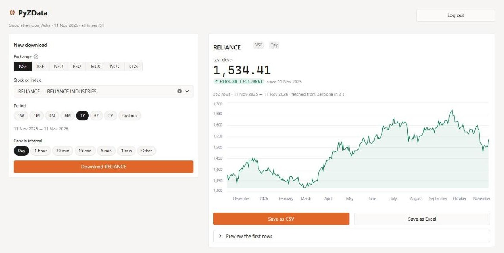

# PyZData


**Download historical prices from Zerodha — stocks, indices, futures, options and
commodities — as CSV, Excel or a pandas DataFrame.**

It's free: you need a Zerodha account, but not the paid Kite Connect API.


<sub>The web app (sample data).</sub>

---

## Get started

1. **Install** (Python 3.10 or newer):

   ```bash
   pip install "pyzdata[web]"
   ```

2. **Start the app** — your browser opens at `http://localhost:8501`:

   ```bash
   pyzdata-web
   ```

3. **Log in** with your [enctoken](#how-to-get-your-enctoken), or your Zerodha user ID,
   password and TOTP.
4. **Pick** a stock or contract, a period and a candle size, then press **Download**.
5. **Save** the result as CSV or Excel.

## How to get your enctoken

1. Log in to [kite.zerodha.com](https://kite.zerodha.com) in your browser.
2. Press **F12** (Mac: **Cmd + Option + I**) to open Developer Tools.
3. Open **Application** (Firefox: **Storage**) → **Cookies** → `kite.zerodha.com`.
4. Copy the value of the `enctoken` cookie.

The enctoken changes every time you log in to Kite. If PyZData says you were logged
out, copy a fresh one.

## What you get

One row per candle, with times in IST, in these columns:

```
tradingsymbol, datetime, open, high, low, close, volume, open_interest
```

`open_interest` is included for futures and options when you ask for it.

- **Candle sizes:** 1, 2, 3, 4, 5, 10, 15 and 30 minutes · 1, 2, 3 and 4 hours · 1 day
- **Exchanges:** NSE and BSE (stocks, indices) · NFO and BFO (futures & options) ·
  MCX and NCO (commodities) · CDS (currency)

## Use it from Python

```python
from pyzdata import PyZData, Interval

with PyZData(enctoken="your_enctoken") as client:
    token = client.get_instrument_token("RELIANCE", "NSE")
    df = client.get_data(token, "2024-01-01", "2024-12-31", Interval.DAY)

df.to_csv("reliance.csv", index=False)
```

- **Not sure of the symbol?** `client.search_instruments("NIFTY", exchange="NSE")`
- **Futures & options with open interest:**
  `client.get_data(token, start, end, Interval.MINUTE_5, oi=True)`
- **Log in with your user ID instead:**
  `PyZData(user_id="AB1234", password="...", totp="123456")`
- **Candle sizes** are `Interval.MINUTE_1` … `Interval.MINUTE_30`, `Interval.HOUR_1` …
  `Interval.HOUR_4` and `Interval.DAY`.
- **Errors:** `AuthenticationError` (login failed or logged out), `InstrumentNotFoundError`
  (unknown symbol), `DataFetchError` (logged out during a download). All are importable
  from `pyzdata`.

Only need Python, not the web app? `pip install pyzdata` is enough.

## Use it from the command line

```bash
# A year of daily candles, saved to a CSV file
pyzdata download --enctoken TOKEN --symbol RELIANCE --exchange NSE \
    --start 2024-01-01 --end 2024-12-31 --output reliance.csv

# 5-minute candles of a futures contract, with open interest
pyzdata download --enctoken TOKEN --symbol NIFTY24JANFUT --exchange NFO \
    --start 2024-01-01 --end 2024-01-25 --interval 5minute --oi --output nifty.csv

# Find the exact symbol
pyzdata search --enctoken TOKEN --query NIFTY --exchange NSE
```

- **Skip typing the token:** set it once with `export PYZDATA_ENCTOKEN=TOKEN`
  (PowerShell: `$env:PYZDATA_ENCTOKEN = "TOKEN"`).
- **Log in with your user ID:** use `--user-id AB1234` instead of `--enctoken`. PyZData
  asks for the password and TOTP, so they stay out of your shell history.
- **All options:** `pyzdata download --help`

## Good to know

- **Downloads don't give up.** If the internet drops or Zerodha is busy, PyZData waits a
  few seconds and tries again until it works. To stop, press **Ctrl+C** in the terminal or
  **Log out** in the web app.
- **Only a logout stops a download** — for example when you log in to Kite somewhere else.
  Log in again and download once more.
- **Long periods are fine.** Zerodha returns a limited span per request (60 days of
  1-minute candles, for example), so PyZData splits longer periods for you. Five years of
  daily candles is a single request.
- **Expired contracts can't be downloaded** — Zerodha only lists active futures and options.
- **Your login stays private.** It goes only to Zerodha, and the web app is reachable
  only from your own computer.
- PyZData is an independent project, not made by or affiliated with Zerodha.

## Settings (optional)

Set these environment variables to change how PyZData behaves:

| Variable | Default | What it does |
|---|---|---|
| `PYZDATA_ENCTOKEN` | — | Enctoken for the command line |
| `PYZDATA_RATE_LIMIT` | `3` | Most requests per second sent to Zerodha |
| `PYZDATA_TIMEOUT` | `30` | Seconds to wait for Zerodha to answer |
| `PYZDATA_CACHE_TTL_HOURS` | `24` | How often the list of instruments is refreshed |
| `PYZDATA_LOG_LEVEL` | — | `INFO` or `DEBUG` to see what PyZData is doing |

The full list is in [.env.example](https://github.com/vikassharma545/Historical-Market-data-From-Zerodha/blob/main/.env.example).

---

[Release notes](https://github.com/vikassharma545/Historical-Market-data-From-Zerodha/blob/main/CHANGELOG.md) ·
[Report a security issue](https://github.com/vikassharma545/Historical-Market-data-From-Zerodha/blob/main/SECURITY.md) ·
[MIT License](https://github.com/vikassharma545/Historical-Market-data-From-Zerodha/blob/main/LICENSE)

Made by [Vikas Sharma](https://github.com/vikassharma545)
